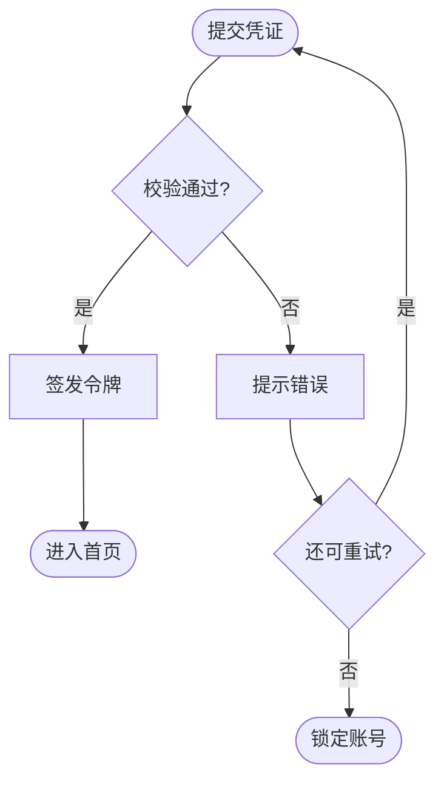

# flowchart-mermaid

用 **Mermaid** 把流程写成可版本管理的文本图：GitHub / GitLab / Notion / 多数 Markdown 预览都能直接渲染。

## 何时用

- 用户要「画流程图 / 工作流 / 决策分支」
- 要把登录、审批、部署、业务状态等过程可视化
- 需要嵌进 README、PR、文档，而不是位图

若用户明确只要 **PowerPoint 里可编辑的形状图**，先画清逻辑，再交给 `pptx-deck`（或导出 PNG/SVG 插入幻灯片）。

## 工作流

1. **确认在画什么**：过程/决策 → 流程图；随时间交互 → 时序图；表结构 → ER；生命周期 → 状态图；排期 → Gantt。含糊时问一句，或选最贴切的并说明理由。
2. **选方向**：流程与层级用 `flowchart TD`；管道/阶段从左到右用 `flowchart LR`。
3. **先节点后样式**：写完节点与边再 `classDef` / `style`；颜色少而有语义，避免硬编码到暗色主题下看不见。
4. **交付前自检**：特殊字符是否加引号、节点 id 是否误用 `end`、是否混用了时序箭头语法。
5. **交付**：用 ```mermaid 代码块；需要图片时再用 CLI 导出。

## 图类型速查

| 意图 | 类型 | 首行关键字 |
|------|------|------------|
| 步骤、判断、工作流 | 流程图 | `flowchart TD` |
| 谁在何时调谁 | 时序图 | `sequenceDiagram` |
| 表/实体关系 | ER | `erDiagram` |
| 类与继承 | 类图 | `classDiagram` |
| 状态迁移 | 状态图 | `stateDiagram-v2` |
| 里程碑排期 | 甘特 | `gantt` |
| 系统边界/服务 | C4 / architecture | `C4Context` 等 |

## 形状约定（流程图）

- 起止：`([圆角起止])`
- 动作：`[矩形]`
- 判断：`{菱形}`
- 数据存储：`[(圆柱)]`
- 子流程：`[[子流程]]`
- 边界：用带标题的 `subgraph`

标签要短；细节放旁边说明文字。含空格、括号、冒号的标签用双引号包起来：`A["Save (draft)"]`。

## 示例



## 清晰度规则

- **一张图一个主题**；节点大约超过 25 个就拆图或加 subgraph。
- 边标签短：`A -- 通过 --> B`；时序图用 `A->>B: 文案`。
- 优先 `stateDiagram-v2`，不要用旧版 `stateDiagram`。
- 需要导出：`npx -p @mermaid-js/mermaid-cli mmdc -i diagram.mmd -o diagram.svg`

## 常见坑

- 节点 id 写成 `end` 会坏图 → 改用 `End` 或换 id
- 标签里未转义的 `()`、`{}`、`#`、`<>` → 整段加引号
- 流程图里用 `->>`，或时序图里用 `-->` → 语法混用必挂
- 漏写首行类型关键字 → 整段不渲染

## 成功标准

- 图类型与用户意图一致
- 在 GitHub Markdown 预览中可渲染
- 标签可读、分支含义清楚；复杂流程已拆分或分组
